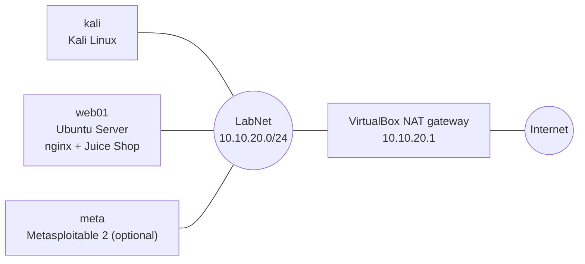

# Lab network

| Host | IP address | Open services |
|---|---|---|
| web01 | 10.10.20.5 (static) | 22 ssh (lab only), 80 http, 3000 Juice Shop |
| kali | 10.10.20.50 (static) | none |
| meta (optional) | 10.10.20.10 (static) | many, deliberately vulnerable |

Why a NAT Network: the machines can download updates, but nothing on my home network or the internet can reach them.

Why static addresses: VirtualBox 7.2 has a known bug where a NAT Network’s DHCP doesn’t hand out addresses, so I turned DHCP off and set each address myself. Fixed addresses also keep my scans and notes consistent.
